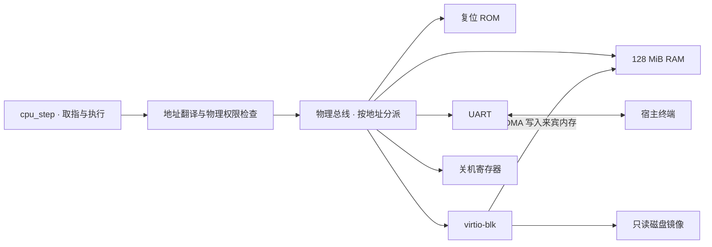

# 整机架构与指令执行

宿主进程中有一个 `Cpu` 和一个 `Bus`。前者保存来宾的寄存器、PC、特权级和地址翻译状态。后者持有 RAM、磁盘流和设备寄存器。来宾程序只能通过指令和板级地址与它们交互。宿主终端上的提示符由来宾内核打印。[整机循环](../VM/main.cpp) · [CPU 状态](../VM/cpu.h) · [板级状态](../VM/bus.h)

## 物理地址图

| 起始地址 | 内容 | 第一次用到的时刻 |
| --- | --- | --- |
| `0x00001000` | 复位 ROM，带入口地址常量 | 上电后的第一次取指 |
| `0x00100000` | 关机寄存器 | 固件报告启动失败或内核执行 `halt` |
| `0x10000000` | 16550 风格 UART 的轮询寄存器 | 固件输出第一行日志 |
| `0x10001000` | 第一个 virtio-mmio 插槽，后续七个每个相隔 4 KiB | 固件查找块设备 |
| `0x80000000` – `0x87ffffff` | 128 MiB RAM，低端存放固件 | 从复位 ROM 跳入固件 |
| `0x80200000` | RAM 内约定的内核装入地址 | 固件读入磁盘第 1 扇区 |

ROM 用 PC 相对寻址取出一个 64 位常量再跳转。在 RV64 上，直接用 `lui` 把 `0x80000` 写入高 20 位会得到符号扩展的 `0xffffffff80000000`。这里需要的物理地址是 `0x0000000080000000`。[ROM 字节与总线译码](../VM/bus.cpp)

## 跟一条指令

以 S 模式下的 `lbu a0, 5(a1)` 为例。假设 `a1 = 0x10000000`，本条指令要读取 UART 状态。

1. `cpu_step` 用当前 PC 取指。低两位标识 16 位或较长编码。32 位指令需要再取一个半字。这两个半字可能位于不同的虚拟页。对压缩指令，展开器给出对应的普通指令编码，顺序 PC 仍按原始长度递增。
2. 译码器取得 `rs1`、`rd`、访存宽度和立即数，计算有效虚拟地址 `0x10000005`。
3. MMU 从 `satp` 取出根页号，找到设备页，检查其读取权限，再以物理权限检查约束最终访问。内核给串口建立了恒等映射，虚拟地址与物理地址数值恰好一样。该页的 U 位为零，因此同一条指令在用户模式下会触发读页故障。
4. 总线把该地址交给 UART。它查询输入是否就绪，把 DR 和发送状态位组成一个字节。CPU 对该字节做零扩展，写入 `a0`，然后推进 PC。

如果第 3 步出现缺页，CPU 会保存故障 PC，转到异常处理入口。本条指令的目标寄存器保持原值。即便目标写成 `x0`，CPU 仍须执行访存和权限检查。丢弃的是最终结果，设备可能仍产生读取副作用。[取指与译码](../VM/cpu.cpp) · [压缩指令展开](../VM/cpu_compressed.cpp) · [访存](../VM/cpu_mmu.cpp)

向量访存逐元素经过同一套 MMU。一条指令可能完成前两个元素才在第三个元素缺页。此时保留已完成的元素，`sepc` 指向整条指令，`vstart` 标出恢复位置。浮点与向量状态分别由 `FS` 和 `VS` 控制，任一状态为 Dirty 时，读取状态寄存器会看到摘要位 `SD=1`。[从点积追到跨页访问](numeric.md)

## 为什么有些算术要单独写

- **整数溢出。** RV64 加减只保留低 64 位。宿主用无符号运算表达这个语义，在有符号比较、除法或算术右移需要时才解释符号位。`DIV` 的零除数和最小负数除以 `-1` 有架构定义的结果，解释器在执行宿主除法前显式处理。
- **乘积高半部。** `MULHU` 取 128 位乘积的高 64 位。实现把每个操作数拆为两个 32 位数位，逐列累加部分积和进位。这样同一份代码可以构建在缺少 `__int128` 的工具链上。
- **32 位结果。** RV64 的 W 类指令会把第 31 位符号扩展至第 63 位。例如 `DIVUW` 先作无符号 32 位除法，随后仍执行符号扩展。
- **内存屏障。** 解释器按顺序执行，每次取指都从内存读取。`FENCE.I` 在这里没有缓存需要清理。来宾固件仍执行这条指令来表达“刚装入的代码可以开始执行”，同一份固件也会在独立参考机上运行。

[整数运算](../VM/cpu_integer.cpp) · [标量位操作](../VM/cpu_bitmanip.cpp) · [指令边界用例](../VM/tests/cpu_tests.cpp)
